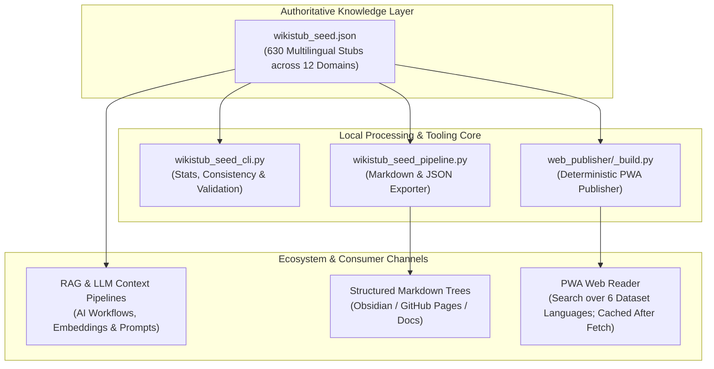
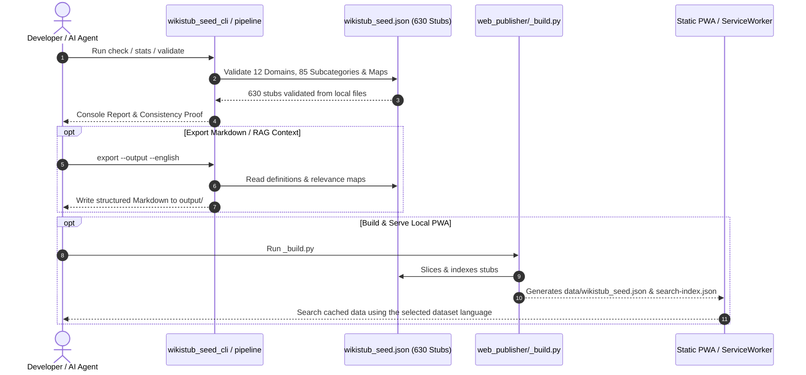

# WikiStub-Seed

**EN** | [DE](README_de.md) | [ES](README_es.md) | [JA](README_ja.md) | [RU](README_ru.md) | [ZH](README_zh-Hans.md)

**WikiStub-Seed is a general-purpose, multilingual JSON knowledge-stub framework: a starter scaffold for any topic, not limited to AI workflows.** It ships 630 compact knowledge stubs across 12 scientific and cultural domains, ready for research, documentation, learning systems, wikis, or AI/LLM workflows alike. Definitions are populated in DE/EN/ES/ZH/JA/RU; relevance notes are populated in DE/ES/ZH/JA/RU and use the documented German fallback for the currently empty English relevance slots.

WikiStub-Seed is a knowledge-stub seed library, not a wiki.

[](https://github.com/dev-bricks/WikiStub-Seed/actions/workflows/tests.yml)
[](pyproject.toml)
[](https://github.com/dev-bricks)
[](https://github.com/open-bricks)


[](https://github.com/astral-sh/ruff)
[](NOTICE)
[](MARKETING-LOG.txt)
[](llms.txt)


### Quick Navigation

- [1. Executive Summary & Core Identity](#1-executive-summary--core-identity)
- [2. Visual Architecture & System Topology](#2-visual-architecture--system-topology)
- [3. Local Workflow & Query Sequence Flow](#3-zero-egress-lifecycle--query-sequence-flow)
- [4. Target Personas & Discoverability Queries](#4-target-personas--discoverability-queries)
- [5. Comparative Matrix vs. Alternatives](#5-comparative-matrix-vs-alternatives)
- [6. Runtime Behavior and Evidence Notes](#6-governance--runtime-invariants-matrix)
- [7. Installation & Quick Start](#7-installation--quick-start)
- [8. Local Edit Mode & HTTP Server (127.0.0.1)](#8-local-edit-mode--http-server-127001)
- [9. Core Commands & CLI Operations](#9-core-commands--cli-operations)
- [10. Repository Map & Key Assets](#10-repository-map--key-assets)
- [11. Data Shape & Knowledge Schema](#11-data-shape--knowledge-schema)
- [12. Sibling Tools & Ecosystem Matrix](#12-sibling-tools--ecosystem-matrix)
- [13. Third-Party License References & Scope](#13-third-party-licenses--level-1-sbom)
- [14. Security Policy & Response Targets](#14-security-policy--operational-limits-48h-sla)
- [15. Static PWA & Web Publisher Architecture](#15-static-pwa--web-publisher-architecture)
- [16. Testing, Verification & CI Matrix](#16-testing-verification--ci-matrix)
- [17. Discovery Keywords & AI Agent Index](#17-discovery-keywords--ai-agent-index)
- [18. License and Attribution](#license)

---

<a id="sec-01"></a><a id="1-executive-summary"></a><a id="1-executive-summary--core-identity"></a>
## 1. Executive Summary & Core Identity

| If you want to... | Open this |
|---|---|
| Inspect the dataset | `wikistub_seed.json` |
| Run a quick local check | `python wikistub_seed_cli.py check` |
| Export Markdown for docs or notes | `python wikistub_seed_pipeline.py export --output --english` |
| Understand the exchange format | `EXPORTFORMAT.md` |
| Read the optional local search contract | `EMBEDDING_SEARCH_API.md` |
| Browse the static PWA source | `web_publisher/` |
| Read AI/LLM index file | [llms.txt](llms.txt) |
| Read the German guide | [README_de.md](README_de.md) |

> [!NOTE]
> **AI & LLM Integration**: For machine-readable context, repository structure, search phrases, and LLM guidelines, see [llms.txt](llms.txt).

### Key Features

- **630 Knowledge Stubs**: Curated in `wikistub_seed.json` with definitions across 6 languages (DE, EN, ES, ZH, JA, RU) and relevance notes across 5 languages.
- **12 Top-Level Domains**: Mathematics, physics, chemistry, biology, medicine, psychology, AI/CS, engineering, society, economics, history, and culture.
- **85 Structured Subcategories**: Short, neutral definitions and practical relevance notes.
- **Source-Checkout Core**: Dataset checks, statistics, and exports use the Python standard library; optional translation, search integrations, and development checks have separate dependencies.
- **Dual Consumption Models**: Batch CLI export to structured Markdown or a static PWA reader that can cache fetched resources and dataset files.

### Use Cases

- Seed a local knowledge base for AI-assisted writing or research.
- Build documentation glossaries, learning maps or concept catalogs.
- Export structured Markdown for Obsidian, GitHub Pages or static documentation sites.
- Feed retrieval, embeddings or LLM context pipelines with compact domain stubs.
- Translate and extend a domain-neutral knowledge skeleton in a controlled JSON format.

---

<a id="sec-02"></a><a id="2-system-architecture--data-flow"></a><a id="2-visual-architecture--system-topology"></a>
## 2. Visual Architecture & System Topology



---

<a id="sec-03"></a><a id="3-zero-egress-lifecycle--query-flow"></a><a id="3-zero-egress-lifecycle--query-sequence-flow"></a>
## 3. Local Workflow & Query Sequence Flow



---

<a id="sec-04"></a><a id="target-personas--discoverability"></a><a id="target-personas--discoverability-queries"></a><a id="4-target-personas--discoverability-queries"></a><a id="14-marketing--target-personas"></a>
## 4. Target Personas & Discoverability Queries

WikiStub-Seed is engineered to address four primary developer and researcher archetypes:

### `[PERSONA-01]` AI & LLM Engineers (RAG & Local Knowledge Injection)
- **Goal:** Inject high-signal, domain-curated knowledge stubs into local LLM contexts, vector stores (FAISS, Chroma, Qdrant), or agent prompts without scraping latency or noisy web HTML.
- **Pain Point:** Raw Wikipedia XML dumps and web scrapes require gigabytes of storage, complex extractors, and produce noisy wikitext boilerplate with unverified schema consistency.
- **Solution:** Deterministic `wikistub_seed.json` (630 stubs) with parallel multilingual definition maps ready for direct JSON or Markdown ingestion (`wikistub_seed_pipeline.py export`).

### `[PERSONA-02]` Domain Researchers, Curators & Ontologists
- **Goal:** Maintain a clean, cross-disciplinary concept hierarchy spanning 12 academic fields (Math, Physics, Chemistry, Biology, Medicine, CS/AI, etc.) with verified terminology.
- **Pain Point:** Enterprise ontology suites (Protégé, OWL, RDF triple stores) impose heavy infrastructure hurdles and steep learning curves for rapid knowledge curation.
- **Solution:** Human-readable JSON structure with built-in validation CLI (`wikistub_seed_cli.py check/stats`), duplicate verification, and local browser GUI (`python edit_server.py`).

### `[PERSONA-03]` Local-First Knowledge Tool Builders
- **Goal:** Build knowledge tools that work with selected local files and can reuse previously fetched web resources when available.
- **Pain Point:** Hosted dictionary and encyclopedia services may transmit queries and require service access or credentials.
- **Solution:** Local JSON workflows, a loopback edit server and a static PWA that can reuse resources after they are cached. Optional translation sends selected text and instructions to Anthropic.

### `[PERSONA-04]` Educators & Technical Documentation Specialists
- **Goal:** Rapidly generate course glossaries, foundational concept notes, and study decks for students in Markdown, Obsidian vaults, or static documentation sites.
- **Pain Point:** Manually compiling bilingual terminology definitions across dozens of disciplines takes weeks of laborious authoring.
- **Solution:** One-command batch export to categorized Markdown directory trees (`wikistub_seed_pipeline.py export --output --english`), easily imported into Obsidian, Docusaurus, or MkDocs.

### High-Intent Discovery Search Queries

| Language | Query String | Intent & Context |
|:---|:---|:---|
| **EN** | `multilingual json knowledge base` | RAG & context seeding |
| **EN** | `llm context dataset 630 stubs bilingual` | LLM prompt enrichment |
| **EN** | `rag knowledge base json python standard library` | Zero-dependency retrieval |
| **EN** | `wikipedia stub seed dataset offline` | Clean Wikipedia alternative |
| **EN** | `structured markdown export for obsidian knowledge vault` | Personal Knowledge Management |
| **EN** | `local rag json starter dataset python` | Offline RAG knowledge scaffold |
| **EN** | `multilingual offline concept stubs 12 domains` | Multi-domain taxonomy seeding |
| **DE** | `Mehrsprachige JSON Wissensbasis Python` | Lokale Begriffsdatenbank |
| **DE** | `Lokale Wissensdatenbank für RAG und LLMs` | KI-Kontextinjektion |
| **DE** | `Strukturierte Konzept-Stubs 12 Domänen` | Multidisziplinäre Ontologie |
| **DE** | `Lokale JSON Wissensverwaltung Python` | Mehrsprachige Wissens-Stubs mit optionaler externer Übersetzung |
| **DE** | `Markdown Export für Obsidian Wissensgraphen` | Offline PKM & Obsidian |
| **DE** | `Lokales RAG JSON Starter-Dataset Python` | Offline RAG Wissens-Scaffold |
| **DE** | `Mehrsprachige Offline Konzept-Stubs 12 Domänen` | Domänen-Taxonomie-Seeding |

---

<a id="sec-05"></a><a id="comparative-matrix-vs-alternatives"></a><a id="comparative-matrix--alternatives"></a><a id="5-comparative-matrix-vs-alternatives"></a>
## 5. Comparative Matrix vs. Alternatives

The following 10-dimension matrix compares `WikiStub-Seed` against common approaches for knowledge seeding and documentation:

| Dimension | WikiStub-Seed | Kiwix / Wikipedia Dumps | MediaWiki / DokuWiki | Raw Web Scrapes (Common Crawl) | Static Docs (Docusaurus / MkDocs) |
|:---|:---|:---|:---|:---|:---|
| **1. Runtime Footprint** | Source-checkout core commands use the Python standard library; API dependencies are listed separately | Dedicated ZIM reader | PHP / MySQL / Web server | Big Data / Spark cluster | Node.js / Python env |
| **2. Deterministic Schema (`INV-SCHEMA-03`)** | Schema-validated JSON dataset | Unstructured wikitext | Ad-hoc wiki formatting | Unstructured text noise | Ad-hoc Markdown / MDX |
| **3. Parallel Multilingual Mapping** | **6 Normalized Languages** | Separate databases | Manual interlanguage links | Unaligned / mixed | Manual i18n configuration |
| **4. RAG & LLM Ingestion Readiness** | **Direct JSON / Markdown feed** | Complex parsing required | Scraping / API required | Heavy tokenization needed | Manual indexing required |
| **5. Local processing and optional network use** | Local file operations; optional translation calls Anthropic | Offline ZIM reader | Depends on hosting | Online scraping required | Local build / Web deploy |
| **6. Unprivileged Mode (`INV-SEC-02`)** | Runs with the current process permissions | User mode | Often requires server root | N/A | User mode |
| **7. Localhost GUI Edit Server (`INV-SRV-05`)** | **Built-in `127.0.0.1` server** | Read-only | Full server CMS | None | Dev preview server |
| **8. Offline PWA Publisher** | Static PWA with a Service Worker cache after fetch | Kiwix client app | Server required | None | Custom plugin needed |
| **9. Project and dependency licenses** | MIT project license; dependency terms are listed separately | CC BY-SA (Copyleft) | GPLv2+ (Copyleft) | Complex copyright status | MIT / Apache-2.0 |
| **10. Security response** | Maintainer response targets documented in SECURITY.md | Community bug tracker | Security team tracker | None | Individual maintainers |

---

<a id="sec-06"></a><a id="4-safety-model--governance-invariants"></a><a id="6-governance--runtime-invariants-matrix"></a>
## 6. Runtime Behavior and Evidence Notes

These notes describe implemented behavior and its limits; they are not certifications or guarantees.

| Topic | Observed behavior | Evidence and limits |
|---|---|---|
| Local processing | CLI checks, exports and local editing use selected local files. Optional translation sends selected text and instructions to Anthropic when invoked with the CLI controls. | See translate.py and the command options below; no general zero-egress claim is made. |
| Process permissions | Commands run with the permissions of the process that starts them. | The project does not claim a formal RunAsInvoker certification. |
| Dataset validation | The CLI validates the dataset structure and reports consistency issues. | See wikistub_seed_cli.py check and wikistub_seed_pipeline.py validate. |
| Storage and network | Dataset and export files are local inputs and outputs; optional translation is an external request. | Network behavior depends on the selected command and optional integrations. |
| Local edit server | The optional edit server binds to loopback. | See edit_server.py; this does not describe a remotely hosted service. |
| Authentication and trash | The editor stores authentication data locally and supports soft-delete trash and restore APIs. | See wiki_auth.py, wiki_store.py, and the editor tests. |
| CI coverage | GitHub Actions tests selected Python, operating-system, source-smoke, PWA and package paths. | The configured matrix is not a claim of identical behavior across all platforms. |
| Dependency scope | Core CLI operations use the Python standard library; optional features and development checks have additional dependencies. | See pyproject.toml and the bounded notes in THIRD_PARTY_LICENSES.md. |
| Sync files | .gitignore excludes common conflict and lock-file patterns. | Ignore rules do not prevent a sync client from operating. |
| Security response | Maintainers aim for the response targets in SECURITY.md. | Targets are not guaranteed service levels. |
---

<a id="sec-07"></a><a id="5-installation--quick-start"></a><a id="7-installation--quick-start"></a>
## 7. Installation & Quick Start

Use a source checkout for the full CLI, editor, dataset, and PWA. The wheel exposes six reusable API modules. Installed API calls require explicitly selected external data and authentication paths; package files are not user-data storage. Module translation APIs require an explicit max_budget_usd; the CLI additionally requires --confirm-api-cost.

```bash
git clone https://github.com/dev-bricks/WikiStub-Seed.git
cd WikiStub-Seed

python wikistub_seed_cli.py --help
python wikistub_seed_cli.py stats
python wikistub_seed_cli.py check
python wikistub_seed_pipeline.py validate
python wikistub_seed_pipeline.py export --output --english
```

On Windows, `start.bat` opens the CLI entry point. Exported files are written to `output/`; that folder is local and not versioned.

---

<a id="sec-08"></a><a id="6-local-edit-mode--http-server"></a><a id="8-local-edit-mode--http-server-127001"></a>
## 8. Local Edit Mode & HTTP Server (127.0.0.1)

`web_publisher/` is a static site (no server, `fetch()`-only) and cannot write. `edit_server.py` adds a small, `127.0.0.1`-only HTTP server on top of it so the same reader UI can create, edit and delete articles/categories:

```bash
python edit_server.py            # default port 8879, opens the browser
```

**Rights model** (verbatim from the specifying request, and the one binding rule this feature follows):

- Creating new entries is allowed by default, for everyone.
- Editing and deleting are allowed for everyone **as long as no password is set**.
- Once a password is set, whoever set it decides what an anonymous visitor may still do — anywhere from "everything" down to read-only (create/edit/delete are independently revocable via the "Konto" panel in the header).
- There is deliberately only **one** password/role. Multiple tokens with different rights plus an administrator role were considered "maybe a bit much" and are documented as a Roadmap idea below, not built.

**Security notes:**

- The edit server is configured to bind to `127.0.0.1`. This limits direct access to the local host; it does not replace host security controls.
- The password is stored as a PBKDF2-HMAC-SHA256 hash (`wiki_auth.json`, gitignored), never in plaintext. This hash defends against a casual read of the file revealing a reused password — it does **not** defend against local filesystem access; anyone who can already read/write files on the machine can replace `wiki_auth.json` outright. Forgotten password? Delete `wiki_auth.json` to return to the default (no password, full rights for everyone).
- Every mutating request must carry `Content-Type: application/json` (rejects classic `<form>`-based CSRF, which cannot send that content type without a CORS preflight this server does not answer) and a `Host` header of `localhost`/`127.0.0.1` (rejects DNS rebinding).
- Deletions are soft: articles and categories move to `wikistub_seed_trash.json` (gitignored) instead of being removed outright, and can be restored via the API.
- **`web_publisher/data/wikistub_seed.json` and `search-index.json` are tracked, committed build artifacts.** Every successful edit-mode write rebuilds them from the same `_build.py` this repository's CI already runs. If you used the local edit server to try something out, `git status` before committing — a local test edit dirties these two files exactly like a real one would, and nothing here git-ignores them for you (they need to stay tracked for GitHub Pages hosting without a build step).

---

<a id="sec-09"></a><a id="7-core-commands--cli-operations"></a><a id="9-core-commands--cli-operations"></a>
## 9. Core Commands & CLI Operations

| Command | Purpose |
|---|---|
| `python wikistub_seed_cli.py stats` | Print stub, category and tag statistics |
| `python wikistub_seed_cli.py check` | Run consistency checks over the JSON dataset |
| `python wikistub_seed_pipeline.py validate` | Validate the pipeline input data |
| `python wikistub_seed_pipeline.py export --output --english` | Export the JSON dataset to Markdown |
| `python wikistub_seed_pipeline.py translate` | Optional external translation; the CLI requires `--confirm-api-cost` and a positive `--max-budget-usd` ceiling |

---

<a id="sec-10"></a><a id="8-repository-map--key-files"></a><a id="10-repository-map--key-assets"></a>
## 10. Repository Map & Key Assets

| Path | Purpose |
|---|---|
| `wikistub_seed.json` | Authoritative multilingual knowledge dataset |
| `01_Mathematik/` ... `12_Kultur_Kunst_Sprache/` | Domain-oriented Markdown source/export structure |
| `wikistub_seed_cli.py` | CLI for stats and checks |
| `wikistub_seed_pipeline.py` | Import, export, validation and optional translation pipeline |
| `md_to_json.py` | Markdown-to-JSON import helper |
| `check_duplicates.py` | Duplicate/consistency helper |
| `EXPORTFORMAT.md` | Stable exchange-format plan |
| `web_publisher/` | Static PWA with search and a dataset-language selector; its service worker can cache successfully fetched resources and data |
| `edit_server.py` | Local-only (`127.0.0.1`) HTTP server adding GUI create/edit/delete to `web_publisher/` |
| `wiki_store.py` | Pure CRUD + soft-delete/trash functions the edit server uses |
| `wiki_auth.py` | Password hashing, permission model and session tracking for the edit server |
| `NOTICE` | Formal attribution and upstream ecosystem notice |
| `SKILL.md` | Standalone product skill for autonomous and pair-programming agents |
| `llm.txt` | Compatibility pointer to canonical `llms.txt` |
| `THIRD_PARTY_LICENSES.md` | Bounded dependency and license notes for the documented project scope |
| `THIRD_PARTY_LICENSES.txt` | Plain-text companion to the bounded dependency and license notes |

---

<a id="sec-11"></a><a id="9-data-shape--knowledge-schema"></a><a id="11-data-shape--knowledge-schema"></a>
## 11. Data Shape & Knowledge Schema

Each stub is intentionally small, machine-readable, and deterministic:

```json
{
  "title": "Domain-Driven Design",
  "definition_de": "Ein Ansatz zur Modellierung komplexer Software, der die Fachdomäne in den Mittelpunkt stellt.",
  "definition_en": "An approach to modeling complex software that places the business domain at the center of development.",
  "relevance": "Hilft, komplexe Systeme verständlich und wartbar zu gestalten.",
  "definitions": {
    "de": "Ein Ansatz zur Modellierung komplexer Software, der die Fachdomäne in den Mittelpunkt stellt.",
    "en": "An approach to modeling complex software that places the business domain at the center of development.",
    "es": "Un enfoque para modelar software complejo que sitúa el dominio de especialidad en el centro.",
    "zh": "一种对复杂软件进行建模的方法，它将专业领域置于中心位置。",
    "ja": "専門領域をその中心に据える、複雑なソフトウェアをモデリングするためのアプローチ。",
    "ru": "Подход к моделированию сложного программного обеспечения, который ставит предметную область в центр внимания."
  },
  "relevance_i18n": {
    "de": "Hilft, komplexe Systeme verständlich und wartbar zu gestalten.",
    "en": "",
    "es": "Ayuda a que los sistemas complejos sean comprensibles y mantenibles.",
    "zh": "有助于使复杂系统更易于理解和维护。",
    "ja": "複雑なシステムを理解しやすく、保守しやすく構築するのに役立ちます。",
    "ru": "Помогает сделать сложные системы понятными и простыми в сопровождении."
  },
  "tags": ["Informatik", "Software Engineering"]
}
```

The current authoritative source is `wikistub_seed.json`. `EXPORTFORMAT.md` documents the stable wrapper format `wikistub-seed-data-v1` for Web/PWA, API and LLM exports.

---

<!-- BEGIN GENERATED ELLMOS BUNDLE DISCOVERY -->

## Bundles and partners

Generated discovery projection for `module:WikiStub-Seed` from `catalog:v4-bundles` (`546290dafbaafd810df1d59ef5a3d7183738472b48cd5a8a81f1e8f2b64d852e`).
Target repository visibility: `public`. Bundle manifests remain the membership authority; this section does not install or activate components.
Discovery approval: `public` module-registry record, explicit default-deny bundle allowlist.

### `ellmos-knowledge-bundle`

- Bundle recipe visibility: `private`; role: `declared-component`; requirement: `recommended`.
- module partners: `module:KnowledgeDigest`, `module:project-docs-template`, `module:report-forge`, `module:web-scraper`.
- skill partners: `skill:bilingual-doc-sync`, `skill:docs-analysis`, `skill:document-chunker`.

Composition and runtime details are intentionally omitted.

<!-- END GENERATED ELLMOS BUNDLE DISCOVERY -->

<a id="sec-12"></a><a id="10-sibling-tools--ecosystem-matrix"></a><a id="12-sibling-tools--ecosystem-matrix"></a>
## 12. Sibling Tools & Ecosystem Matrix

WikiStub-Seed is part of the **dev-bricks** developer suite and the wider **open-bricks** ecosystem:

| Tool | Organization | Purpose |
| --- | --- | --- |
| [`dev-bricks/DevCenter`](https://github.com/dev-bricks/DevCenter) | dev-bricks | Unified developer dashboard, repo health overview & project launcher |
| [`dev-bricks/CodeBox`](https://github.com/dev-bricks/CodeBox) | dev-bricks | Lightweight PySide6 desktop IDE with syntax highlighting & terminal |
| [`dev-bricks/MethodenAnalyser`](https://github.com/dev-bricks/MethodenAnalyser) | dev-bricks | AST-based Python code analysis, import optimizer & dead-code detection |
| [`dev-bricks/CareCenter-for-Codex`](https://github.com/dev-bricks/CareCenter-for-Codex) | dev-bricks | Workspace health check, diagnostics & test orchestration |
| [`dev-bricks/safe-start-for-codex`](https://github.com/dev-bricks/safe-start-for-codex) | dev-bricks | Safe initialization and verification for development workspaces |
| [`dev-bricks/automation-master`](https://github.com/dev-bricks/automation-master) | dev-bricks | Automated release management and workflow orchestration |
| [`dev-bricks/automizer-for-claude-desktop`](https://github.com/dev-bricks/automizer-for-claude-desktop) | dev-bricks | Claude Desktop scheduled task and workflow automation utility |
| [`ellmos-ai/project-docs-template`](https://github.com/ellmos-ai/project-docs-template) | ellmos-ai | Documentation template and generator |
| [`ellmos-ai/policy-registry`](https://github.com/ellmos-ai/policy-registry) | ellmos-ai | Declarative governance and machine-readable policy enforcement engine |
| [`ellmos-ai/sqlite-transit-sync`](https://github.com/ellmos-ai/sqlite-transit-sync) | ellmos-ai | Local SQLite synchronization and replication project |
| [`doc-bricks/PDFtoPDFocr`](https://github.com/doc-bricks/PDFtoPDFocr) | doc-bricks | OCR tool for PDF files |
| [`doc-bricks/MediaBrain`](https://github.com/doc-bricks/MediaBrain) | doc-bricks | Multimedia indexing and transcription tools |
| [`doc-bricks/DokuReader`](https://github.com/doc-bricks/DokuReader) | doc-bricks | Document reader and semantic exploration desktop environment |
| [`doc-bricks/CleanMarkdown`](https://github.com/doc-bricks/CleanMarkdown) | doc-bricks | Markdown formatting, linting and structure standardization tool |
| [`file-bricks/WinStorePackager`](https://github.com/file-bricks/WinStorePackager) | file-bricks | Automated MSIX packager for Python & PySide6 desktop apps |
| [`file-bricks/NoteSpaceLLM`](https://github.com/file-bricks/NoteSpaceLLM) | file-bricks | Note management and semantic retrieval system for desktop |
| [`open-bricks/open-bricks`](https://github.com/open-bricks/open-bricks) | open-bricks | Umbrella repository for all open-source bricks components |

---

<a id="sec-13"></a><a id="13-third-party-licenses--transparency"></a><a id="13-third-party-licenses--level-1-sbom"></a>
## 13. Third-Party License References & Scope

The repository is licensed under MIT. The files below provide attribution and a bounded set of dependency and license references; they are not a complete software bill of materials or a comprehensive license audit.

- Repository License: [LICENSE](LICENSE)
- Attribution Notice: [NOTICE](NOTICE)
- Dependency and license notes: [THIRD_PARTY_LICENSES.md](THIRD_PARTY_LICENSES.md) describes declared project dependencies and the limits of the checked snapshot.
- Plain-text companion: [THIRD_PARTY_LICENSES.txt](THIRD_PARTY_LICENSES.txt) contains the corresponding bounded notes.
---

<a id="sec-14"></a><a id="12-security--vulnerability-reporting"></a><a id="14-security-policy--operational-limits-48h-sla"></a>
## 14. Security Policy & Response Targets

Use [SECURITY.md](SECURITY.md) for supported-version information and private reporting options. Maintainers aim to acknowledge reports within 48 hours and perform an initial triage within five business days; these are response targets, not guaranteed service levels.

- Private Reporting: [GitHub Security Advisories](https://github.com/dev-bricks/WikiStub-Seed/security/advisories)
- Direct Contacts: security@open-bricks.org, security@ellmos.ai, support@lukasgeiger.com, lukas@open-bricks.org ([SECURITY.md](SECURITY.md))
---

<a id="sec-15"></a><a id="15-static-pwa--web-publisher-architecture"></a><a id="15-german-documentation--deutsche-version"></a>
## 15. Static PWA & Web Publisher Architecture

The web_publisher/ directory contains a static Progressive Web App:
- Runtime: Vanilla ES6, HTML5, and CSS3; the generated files need no build step when served.
- Service Worker cache: Previously fetched app resources and data may be available offline. The first visit and updates require access to the host.
- Dataset language: The selector chooses the displayed dataset language; it does not mean every part of the interface is translated into six languages.
- Search: Client-side search uses the generated search index.
- German documentation: See README_de.md.
---

<a id="sec-16"></a><a id="16-testing-verification--ci-matrix"></a>
## 16. Testing, Verification & CI Matrix

Run the checks appropriate to the change:

```bash
python -m pytest
ruff check .
node --test web_publisher/tests/publisher.test.mjs
```

GitHub Actions runs the Python matrix on Ubuntu, Windows, and macOS with Python 3.10 through 3.13. A separate Python 3.11 source smoke runs on Ubuntu and macOS, PWA tests run on Ubuntu, and package/artifact checks run in their configured jobs. These jobs cover selected paths; they do not establish identical behavior on every platform.
---

<a id="sec-17"></a><a id="11-discovery--search-keywords"></a><a id="17-discovery-keywords--ai-agent-index"></a>
## 17. Discovery Keywords & AI Agent Index

Use the canonical repository name `dev-bricks/WikiStub-Seed` when linking or searching. The project was formerly connected to `file-bricks/MetaWiki`, but the current repo is the dev-bricks knowledge-stub seed library.

Machine-readable index and LLM guidance: [llms.txt](llms.txt).

Search phrases:
- `WikiStub-Seed JSON knowledge stubs`
- `bilingual JSON knowledge base Python`
- `local-first ontology seed library for LLM workflows`
- `multilingual knowledge stubs framework`
- `RAG knowledge base German English JSON`
- `static PWA knowledge publisher offline`
- `domain knowledge ontology open source Python`

---

<a id="sec-18"></a><a id="statutory-notice--liability-limitation"></a><a id="license--statutory-liability-limitation"></a><a id="18-statutory-notice-liability-limitation--license--521-bgb"></a><a id="license"></a>
## 18. License and Attribution

WikiStub-Seed is distributed under the [MIT License](LICENSE). Repository attribution is recorded in [NOTICE](NOTICE). The dependency and license notes in [THIRD_PARTY_LICENSES.md](THIRD_PARTY_LICENSES.md) are limited to their stated scope.
