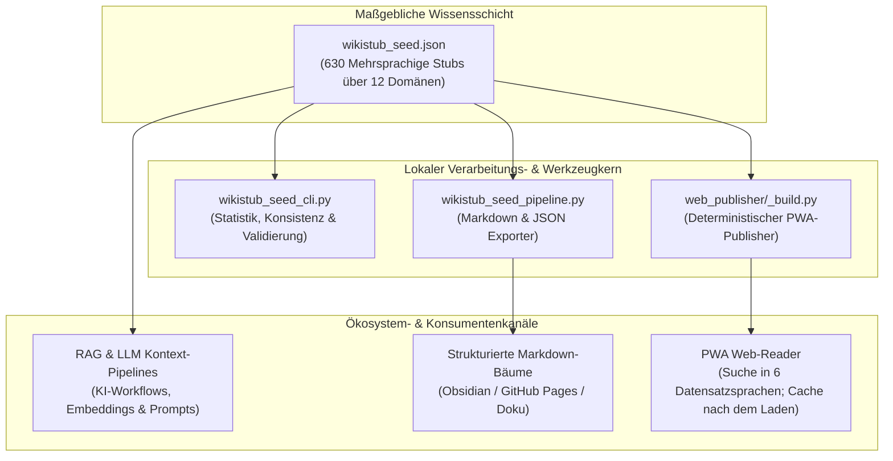
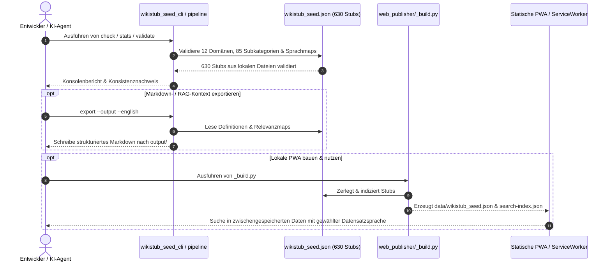

# WikiStub-Seed

[EN](README.md) | **DE** | [ES](README_es.md) | [JA](README_ja.md) | [RU](README_ru.md) | [ZH](README_zh-Hans.md)

**WikiStub-Seed ist ein allgemeines, mehrsprachiges JSON-Wissens-Stub-Gerüst: ein Startgerüst für beliebige Themen, nicht nur für KI-Workflows.** Es enthält 630 kompakte Wissens-Stubs über 12 Wissenschafts- und Kulturbereiche, einsetzbar für Forschung, Dokumentation, Lernsysteme, Wikis oder KI-/LLM-Workflows gleichermaßen. Definitionen sind in DE/EN/ES/ZH/JA/RU gepflegt; Relevanztexte in DE/ES/ZH/JA/RU, während leere englische Relevanzslots den dokumentierten deutschen Fallback nutzen.

WikiStub-Seed ist eine Wissens-Stub-Seed-Bibliothek, kein Wiki.

[](https://github.com/dev-bricks/WikiStub-Seed/actions/workflows/tests.yml)
[](pyproject.toml)
[](https://github.com/dev-bricks)
[](https://github.com/open-bricks)


[](https://github.com/astral-sh/ruff)
[](NOTICE)
[](MARKETING-LOG.txt)
[](llms.txt)


### Schnellnavigation

- [1. Übersicht & Management Summary](#1-übersicht--management-summary)
- [2. Visuelle Architektur & Systemtopologie](#2-visuelle-architektur--systemtopologie)
- [3. Lokaler Ablauf & Abfrage-Sequenzfluss](#3-zero-egress-lebenszyklus--abfrage-sequenzfluss)
- [4. Zielgruppen & Discoverability-Suchanfragen](#4-zielgruppen--discoverability-suchanfragen)
- [5. Vergleichsmatrix gegenüber Alternativen](#5-vergleichsmatrix-gegenüber-alternativen)
- [6. Laufzeitverhalten und Belege](#6-governance--laufzeit-invarianten-matrix)
- [7. Installation & Schnellstart](#7-installation--schnellstart)
- [8. Lokaler Editiermodus & HTTP-Server (127.0.0.1)](#8-lokaler-editiermodus--http-server-127001)
- [9. Kernbefehle & CLI-Betrieb](#9-kernbefehle--cli-betrieb)
- [10. Repository-Struktur & Hauptdateien](#10-repository-struktur--hauptdateien)
- [11. Datenstruktur & Wissensschema](#11-datenstruktur--wissensschema)
- [12. Geschwisterwerkzeuge & Ökosystem-Matrix](#12-geschwisterwerkzeuge--ökosystem-matrix)
- [13. Drittanbieter-Lizenzhinweise & Umfang](#13-drittanbieter-lizenzen--level-1-sbom)
- [14. Sicherheitsrichtlinie & Reaktionsziele](#14-sicherheitsrichtlinie--betriebsgrenzen-48h-sla)
- [15. Statische PWA & Web-Publisher-Architektur](#15-statische-pwa--web-publisher-architektur)
- [16. Test-Matrix, Verifikation & CI](#16-test-matrix-verifikation--ci)
- [17. Auffindbarkeit & KI-Agenten-Index](#17-auffindbarkeit--ki-agenten-index)
- [18. Lizenz und Namensnennung](#lizenz)

---

<a id="sec-01"></a><a id="1-übersicht--management-summary"></a>
## 1. Übersicht & Management Summary

| Wenn du... | Öffne dies |
|---|---|
| Den Datensatz prüfen willst | `wikistub_seed.json` |
| Einen schnellen lokalen Check ausführen willst | `python wikistub_seed_cli.py check` |
| Markdown für Doku oder Notizen exportieren willst | `python wikistub_seed_pipeline.py export --output --english` |
| Das Austauschformat verstehen willst | `EXPORTFORMAT.md` |
| Den optionalen lokalen Suchvertrag lesen willst | `EMBEDDING_SEARCH_API.md` |
| Die statische PWA-Quelle ansehen willst | `web_publisher/` |
| Die KI/LLM-Indexdatei lesen willst | [llms.txt](llms.txt) |
| Die englische Anleitung lesen willst | [README.md](README.md) |

> [!NOTE]
> **KI- & LLM-Integration**: Für maschinenlesbaren Kontext, Repository-Struktur, Suchphrasen und LLM-Richtlinien siehe [llms.txt](llms.txt).

### Hauptmerkmale

- **630 Wissens-Stubs**: Kuratiert in `wikistub_seed.json` mit Definitionen in 6 Sprachen (DE, EN, ES, ZH, JA, RU) und Relevanztexten in 5 Sprachen.
- **12 Wissenschafts- und Kulturbereiche**: Mathematik, Physik, Chemie, Biologie, Medizin, Psychologie, KI/Informatik, Ingenieurwesen, Gesellschaft, Wirtschaft, Geschichte und Kultur.
- **85 Strukturierte Unterkategorien**: Prägnante, neutrale Definitionen und praxisnahe Relevanzhinweise.
- **Source-Checkout-Kern**: Datensatzprüfungen, Statistiken und Exporte nutzen die Python-Standardbibliothek; optionale Übersetzung, Suchintegrationen und Entwicklungsprüfungen haben separate Abhängigkeiten.
- **Duale Nutzungspfade**: CLI-Stapelexport zu strukturiertem Markdown oder ein statischer PWA-Reader, der geladene Ressourcen und Datensatzdateien cachen kann.

### Anwendungsfälle

- Lokale Wissensbasis für KI-gestütztes Schreiben oder Recherchieren anlegen.
- Dokumentationsglossare, Lernkarten oder Konzeptkataloge erstellen.
- Strukturiertes Markdown für Obsidian, GitHub Pages oder statische Dokumentationsseiten exportieren.
- Retrieval-, Embedding- oder LLM-Kontext-Pipelines mit kompakten Domänen-Stubs befüllen.
- Ein domänenneutrales Wissensgerüst in einem kontrollierten JSON-Format übersetzen und erweitern.

---

<a id="sec-02"></a><a id="2-systemarchitektur--datenfluss"></a><a id="2-visuelle-architektur--systemtopologie"></a>
## 2. Visuelle Architektur & Systemtopologie



---

<a id="sec-03"></a><a id="3-zero-egress-lebenszyklus--abfragefluss"></a><a id="3-zero-egress-lebenszyklus--abfrage-sequenzfluss"></a>
## 3. Lokaler Ablauf & Abfrage-Sequenzfluss



---

<a id="sec-04"></a><a id="zielgruppen--auffindbarkeit"></a><a id="zielgruppen--suchanfragen"></a><a id="4-zielgruppen--discoverability-suchanfragen"></a><a id="14-marketing--zielgruppen"></a>
## 4. Zielgruppen & Discoverability-Suchanfragen

WikiStub-Seed adressiert vier zentrale Entwickler- und Forscherprofile:

### `[PERSONA-01]` KI- & LLM-Entwickler (RAG & Lokale Wissensinjektion)
- **Ziel:** Hochwertige, domänenkuratierte Wissens-Stubs ohne Scraping-Latenzen oder Web-HTML-Rauschen in lokale LLM-Kontexte, Vektordatenbanken (FAISS, Chroma, Qdrant) oder Agenten-Prompts einspeisen.
- **Problem:** Rohe Wikipedia-XML-Dumps und Web-Scrapes sind gigabyteschwer, erfordern komplexe Parser und liefern unstrukturierte Wikitext-Fragmente mit uneinheitlichen Schemata.
- **Lösung:** Deterministische `wikistub_seed.json` (630 Stubs) mit parallelen mehrsprachigen Definitionsfeldern für direkte JSON- oder Markdown-Aufnahme (`wikistub_seed_pipeline.py export`).

### `[PERSONA-02]` Domänenforscher, Kuratoren & Ontologen
- **Ziel:** Eine saubere, fächerübergreifende Begriffshierarchie über 12 akademische Disziplinen (Mathematik, Physik, Chemie, Biologie, Medizin, Informatik/KI etc.) mit geprüfter Terminologie pflegen.
- **Problem:** Komplexe Enterprise-Ontologie-Suiten (Protégé, OWL, RDF-Triple-Stores) erfordern enorme Infrastruktur und steile Lernkurven für schnelle Begriffsarbeit.
- **Lösung:** Menschenlesbare JSON-Struktur mit integrierter Validierungs-CLI (`wikistub_seed_cli.py check/stats`), Duplikatprüfung und lokaler Browser-GUI (`python edit_server.py`).

### `[PERSONA-03]` Entwickler lokaler Wissenswerkzeuge
- **Ziel:** Wissenswerkzeuge entwickeln, die ausgewählte lokale Dateien nutzen und zuvor geladene Webressourcen bei Verfügbarkeit wiederverwenden können.
- **Problem:** Gehostete Wörterbuch- und Lexikondienste können Suchanfragen übertragen und Dienstzugriff oder Zugangsdaten voraussetzen.
- **Lösung:** Lokale JSON-Abläufe, ein an Loopback gebundener Editier-Server und eine statische PWA, die Ressourcen nach dem Laden erneut verwenden kann. Die optionale Übersetzung sendet ausgewählten Text und Anweisungen an Anthropic.

### `[PERSONA-04]` Bildungs- und Dokumentationsteams
- **Ziel:** Schnell Glossare, Begriffskarten und Studiendecks für Lernende in Markdown, Obsidian-Vaults oder statischen Dokumentationsseiten bereitstellen.
- **Problem:** Das manuelle Verfassen zweisprachiger Begriffsdefinitionen über Dutzende Fachdisziplinen erfordert wochenlangen redaktionellen Aufwand.
- **Lösung:** Stapelexport mit einem einzigen Befehl in thematisch sortierte Markdown-Ordner (`wikistub_seed_pipeline.py export --output --english`), direkt importierbar in Obsidian, Docusaurus oder MkDocs.

### Relevante Suchanfragen (High-Intent SEO)

| Sprache | Suchanfrage | Kontext & Absicht |
|:---|:---|:---|
| **DE** | `Mehrsprachige JSON Wissensbasis Python` | Lokale Begriffsdatenbank |
| **DE** | `Lokale Wissensdatenbank für RAG und LLMs` | KI-Kontextinjektion |
| **DE** | `Strukturierte Konzept-Stubs 12 Domänen` | Multidisziplinäre Ontologie |
| **DE** | `Mehrsprachige JSON-Wissens-Stubs mit Python` | Strukturierte Wissensbasis |
| **DE** | `Markdown Export für Obsidian Wissensgraphen` | Offline PKM & Obsidian |
| **DE** | `Lokales RAG JSON Starter-Dataset Python` | Offline RAG Wissens-Scaffold |
| **DE** | `Mehrsprachige Offline Konzept-Stubs 12 Domänen` | Domänen-Taxonomie-Seeding |
| **EN** | `local-first multilingual json knowledge base` | RAG & context seeding |
| **EN** | `llm context dataset 630 stubs bilingual` | LLM prompt enrichment |
| **EN** | `rag knowledge base json python standard library` | Zero-dependency retrieval |
| **EN** | `wikipedia stub seed dataset offline` | Clean Wikipedia alternative |
| **EN** | `structured markdown export for obsidian knowledge vault` | Personal Knowledge Management |
| **EN** | `local rag json starter dataset python` | Offline RAG knowledge scaffold |
| **EN** | `multilingual offline concept stubs 12 domains` | Multi-domain taxonomy seeding |

---

<a id="sec-05"></a><a id="vergleichsmatrix-gegenueber-alternativen"></a><a id="vergleichsmatrix--alternativen"></a><a id="5-vergleichsmatrix-gegenüber-alternativen"></a>
## 5. Vergleichsmatrix gegenüber Alternativen

Die folgende 10-Dimensionen-Matrix vergleicht `WikiStub-Seed` mit gängigen Ansätzen zur Wissensbereitstellung und Dokumentation:

| Dimension | WikiStub-Seed | Kiwix / Wikipedia-Dumps | MediaWiki / DokuWiki | Rohe Web-Scrapes (Common Crawl) | Statische Doku (Docusaurus / MkDocs) |
|:---|:---|:---|:---|:---|:---|
| **1. Laufzeit-Footprint** | Source-Checkout-Kernbefehle verwenden die Python-Standardbibliothek; API-Abhängigkeiten sind separat aufgeführt | Dedizierter ZIM-Reader | PHP / MySQL / Webserver | Big Data / Spark-Cluster | Node.js / Python-Env |
| **2. Deterministisches Schema (`INV-SCHEMA-03`)** | JSON-Datensatz mit Schema-Prüfung | Unstrukturierter Wikitext | Freie Wiki-Syntax | Unstrukturierter Text-Müll | Ad-hoc Markdown / MDX |
| **3. Parallele Sprachabbildung** | **6 Normalisierte Sprachen** | Getrennte Datenbanken | Manuelle Sprachlinks | Unausgerichtet / gemischt | Manuelle i18n-Konfiguration |
| **4. RAG- & LLM-Aufnahmebereitschaft** | **Direkter JSON-/Markdown-Feed** | Komplexes Parsing nötig | Scraping / API erforderlich | Aufwändige Filterung nötig | Manuelle Indizierung |
| **5. Lokale Verarbeitung und optionale Netzwerknutzung** | Lokale Dateiabläufe; optionale Übersetzung ruft Anthropic auf | Lokaler ZIM-Reader | Serverabhängig | Online-Scraping erforderlich | Lokaler Build / Web-Deploy |
| **6. Unprivilegierter Modus (`INV-SEC-02`)** | Nutzt die Berechtigungen des gestarteten Prozesses | Anwendermodus | Erfordert oft Server-Root | N/A | Anwendermodus |
| **7. Lokaler GUI-Editierserver (`INV-SRV-05`)** | **Integrierter `127.0.0.1`-Server** | Schreibgeschützt | Vollständiges CMS | Keine | Entwicklungs-Vorschau |
| **8. Offline-PWA-Publisher** | Statische PWA mit Service-Worker-Cache nach dem Laden | Kiwix-Client-App | Webserver zwingend | Keine | Eigenes Plugin nötig |
| **9. Projekt- und Abhängigkeitslizenzen** | MIT-Projektlizenz; Abhängigkeitshinweise stehen separat | CC BY-SA (Copyleft) | GPLv2+ (Copyleft) | Komplexe Urheberrechte | MIT / Apache-2.0 |
| **10. Sicherheitsreaktion** | Reaktionsziele der Maintainer, dokumentiert in SECURITY.md | Community-Bugtracker | Security-Team-Tracker | Keine | Einzelne Maintainer |

---

<a id="sec-06"></a><a id="4-sicherheitsmodell--governance-invarianten"></a><a id="6-governance--laufzeit-invarianten-matrix"></a><a id="6-governance---laufzeit-invarianten-matrix"></a>
## 6. Laufzeitverhalten und Beleggrenzen

Diese Hinweise beschreiben implementiertes Verhalten und seine Grenzen; sie sind keine Zertifizierungen oder Garantien.

| Thema | Beobachtetes Verhalten | Belege und Grenzen |
|---|---|---|
| Lokale Verarbeitung | CLI-Prüfungen, Exporte und lokale Bearbeitung verwenden ausgewählte Dateien. Die optionale Übersetzung sendet bei CLI-Aufruf ausgewählten Text und Anweisungen an Anthropic. | Siehe translate.py und die CLI-Optionen unten; es wird keine allgemeine Zero-Egress-Garantie behauptet. |
| Prozessrechte | Befehle laufen mit den Berechtigungen des startenden Prozesses. | Das Projekt beansprucht keine formale RunAsInvoker-Zertifizierung. |
| Datensatzprüfung | Die CLI prüft die Datensatzstruktur und meldet Konsistenzprobleme. | Siehe wikistub_seed_cli.py check und wikistub_seed_pipeline.py validate. |
| Speicherung und Netzwerk | Datensatz- und Exportdateien sind lokale Ein- und Ausgaben; die optionale Übersetzung ist eine externe Anfrage. | Das Netzwerkverhalten hängt vom gewählten Befehl und den optionalen Integrationen ab. |
| Lokaler Editier-Server | Der optionale Editier-Server bindet an Loopback. | Siehe edit_server.py; dies beschreibt keinen öffentlich gehosteten Dienst. |
| Anmeldung und Papierkorb | Der Editor speichert Authentifizierungsdaten lokal und bietet Soft-Delete-Papierkorb sowie Restore-API. | Siehe wiki_auth.py, wiki_store.py und die Editor-Tests. |
| CI-Abdeckung | GitHub Actions prüft ausgewählte Python-, Betriebssystem-, Source-Smoke-, PWA- und Paketpfade. | Die konfigurierte Matrix behauptet keine identische Funktion auf allen Plattformen. |
| Abhängigkeitsumfang | Zentrale CLI-Befehle nutzen die Python-Standardbibliothek; optionale Funktionen und Entwicklungsprüfungen benötigen weitere Pakete. | Siehe pyproject.toml und die begrenzten Hinweise in THIRD_PARTY_LICENSES.md. |
| Sync-Dateien | .gitignore schließt verbreitete Konflikt- und Lockdateimuster aus. | Ignore-Regeln verhindern nicht, dass ein Sync-Client arbeitet. |
| Sicherheitsreaktion | Die Maintainer streben die Reaktionsziele aus SECURITY.md an. | Es handelt sich nicht um garantierte Service-Level. |
---

<a id="sec-07"></a><a id="5-installation--schnellstart"></a><a id="7-installation--schnellstart"></a>
## 7. Installation & Schnellstart

Für die vollständige CLI, den Editor, den Datensatz und die PWA verwende einen Source-Checkout. Das Wheel stellt sechs wiederverwendbare API-Module bereit. Installierte API-Aufrufe benötigen ausdrücklich ausgewählte externe Daten- und Authentifizierungspfade; Paketdateien dienen nicht als Nutzerdatenspeicher. Die Übersetzungs-APIs verlangen ein explizites max_budget_usd; die CLI benötigt zusätzlich --confirm-api-cost.

```bash
git clone https://github.com/dev-bricks/WikiStub-Seed.git
cd WikiStub-Seed

python wikistub_seed_cli.py --help
python wikistub_seed_cli.py stats
python wikistub_seed_cli.py check
python wikistub_seed_pipeline.py validate
python wikistub_seed_pipeline.py export --output --english
```

Unter Windows öffnet `start.bat` den CLI-Einstiegspunkt. Exportierte Dateien werden nach `output/` geschrieben; dieser Ordner ist lokal und wird nicht versioniert.

---

<a id="sec-08"></a><a id="6-lokaler-editiermodus--http-server"></a><a id="8-lokaler-editiermodus--http-server-127001"></a>
## 8. Lokaler Editiermodus & HTTP-Server (127.0.0.1)

`web_publisher/` ist eine statische Website (kein Server, nur `fetch()`) und kann nicht schreiben. `edit_server.py` fügt einen schlanken, ausschließlich an `127.0.0.1` gebundenen HTTP-Server hinzu, mit dem dieselbe Reader-Oberfläche Artikel und Kategorien anlegen, bearbeiten und löschen kann:

```bash
python edit_server.py            # Standardport 8879, öffnet den Browser
```

**Rechtemodell** (wortgetreu nach Anforderungsspezifikation):

- Das Anlegen neuer Einträge ist standardmäßig für jeden erlaubt.
- Bearbeiten und Löschen sind für jeden erlaubt, **solange kein Passwort gesetzt ist**.
- Sobald ein Passwort vergeben wurde, bestimmt derjenige, was anonyme Besucher noch tun dürfen – von „alles“ bis „nur lesen“ (Anlegen, Bearbeiten und Löschen können über das Panel „Konto“ unabhängig voneinander entzogen werden).
- Es gibt bewusst nur **ein** Passwort und eine Rolle.

**Sicherheitshinweise:**

- Der Editier-Server ist für eine Bindung an `127.0.0.1` konfiguriert. Das begrenzt den direkten Zugriff auf den lokalen Rechner und ersetzt keine Host-Sicherheitsmaßnahmen.
- Das Passwort wird als PBKDF2-HMAC-SHA256-Hash gespeichert (`wiki_auth.json`, gitignored), niemals im Klartext. Bei vergessenem Passwort: Datei `wiki_auth.json` löschen, um den Ausgangszustand wiederherzustellen.
- Jede mutierende Anfrage erfordert den Header `Content-Type: application/json` (schützt vor formularbasiertem CSRF) und prüft den `Host`-Header auf `localhost`/`127.0.0.1` (DNS-Rebinding-Schutz).
- Löschvorgänge sind weich (Soft-Delete): Einträge landen in `wikistub_seed_trash.json` (gitignored) und können über die API wiederhergestellt werden.
- **`web_publisher/data/wikistub_seed.json` und `search-index.json` sind versionierte Build-Artefakte.** Jeder erfolgreiche Schreibvorgang im Editiermodus baut diese neu.

---

<a id="sec-09"></a><a id="7-kernbefehle--cli-betrieb"></a><a id="9-kernbefehle--cli-betrieb"></a>
## 9. Kernbefehle & CLI-Betrieb

| Befehl | Zweck |
|---|---|
| `python wikistub_seed_cli.py stats` | Stub-, Kategorie- und Tag-Statistiken ausgeben |
| `python wikistub_seed_cli.py check` | Konsistenzprüfungen über den JSON-Datensatz ausführen |
| `python wikistub_seed_pipeline.py validate` | Eingangsdaten der Pipeline validieren |
| `python wikistub_seed_pipeline.py export --output --english` | JSON-Datensatz als strukturiertes Markdown exportieren |
| `python wikistub_seed_pipeline.py translate` | Optionale externe Übersetzung; die CLI verlangt `--confirm-api-cost` und ein positives `--max-budget-usd`-Limit |

---

<a id="sec-10"></a><a id="8-repository-struktur--hauptdateien"></a><a id="10-repository-struktur--hauptdateien"></a>
## 10. Repository-Struktur & Hauptdateien

| Pfad | Zweck |
|---|---|
| `wikistub_seed.json` | Maßgeblicher mehrsprachiger Wissensdatensatz |
| `01_Mathematik/` ... `12_Kultur_Kunst_Sprache/` | Domänenorientierte Markdown-Struktur |
| `wikistub_seed_cli.py` | CLI für Statistiken und Prüfungen |
| `wikistub_seed_pipeline.py` | Import-, Export-, Validierungs- und optionale Übersetzungspipeline |
| `md_to_json.py` | Markdown-nach-JSON Import-Helfer |
| `check_duplicates.py` | Konsistenz- und Duplikathelfer |
| `EXPORTFORMAT.md` | Stabiler Austauschformat-Plan |
| `web_publisher/` | Statische PWA mit Suche und Datensatz-Sprachauswahl; der Service Worker kann erfolgreich geladene Ressourcen und Daten cachen |
| `edit_server.py` | Lokaler (`127.0.0.1`) HTTP-Server für GUI-Operationen in `web_publisher/` |
| `wiki_store.py` | CRUD- und Soft-Delete-Funktionen für den Editierserver |
| `wiki_auth.py` | Passworthashing, Rechtemodell und Session-Tracking |
| `NOTICE` | Formeller Zurechnungs- und Ökosystem-Urheberrechtshinweis |
| `THIRD_PARTY_LICENSES.md` | Begrenzte Hinweise zu dokumentierten Abhängigkeiten und Lizenzen |
| `THIRD_PARTY_LICENSES.txt` | Klartext-Begleitdatei zu den begrenzten Abhängigkeits- und Lizenzhinweisen |

---

<a id="sec-11"></a><a id="9-datenstruktur--wissensschema"></a><a id="11-datenstruktur--wissensschema"></a>
## 11. Datenstruktur & Wissensschema

Jeder Stub ist bewusst kompakt, maschinenlesbar und deterministisch aufgebaut:

```json
{
  "title": "Domain-Driven Design",
  "definition_de": "Ein Ansatz zur Modellierung komplexer Software, der die Fachdomäne in den Mittelpunkt stellt.",
  "definition_en": "An approach to modeling complex software that places the business domain at the center of development.",
  "relevance": "Hilft, komplexe Systeme verständlich und wartbar zu gestalten.",
  "definitions": {
    "de": "Ein Ansatz zur Modellierung komplexer Software, der die Fachdomäne in den Mittelpunkt stellt.",
    "en": "An approach to modeling complex software that places the business domain at the center of development.",
    "es": "Un enfoque para modelar software complejo que sitúa el dominio de especialidad en el centro.",
    "zh": "一种对复杂软件进行建模的方法，它将专业领域置于中心位置。",
    "ja": "専門領域をその中心に据える、複雑なソフトウェアをモデリングするためのアプローチ。",
    "ru": "Подход к моделированию сложного программного обеспечения, который ставит предметную область в центр внимания."
  },
  "relevance_i18n": {
    "de": "Hilft, komplexe Systeme verständlich und wartbar zu gestalten.",
    "en": "",
    "es": "Ayuda a que los sistemas complejos seien comprensibles y mantenibles.",
    "zh": "有助于使复杂系统更易于理解和维护。",
    "ja": "複雑なシステムを理解しやすく、保守しやすく構築するのに役立ちます。",
    "ru": "Помогает сделать сложные системы понятными и простыми в сопровождении."
  },
  "tags": ["Informatik", "Software Engineering"]
}
```

Die maßgebliche Datenquelle ist `wikistub_seed.json`. `EXPORTFORMAT.md` dokumentiert das stabile Wrapper-Format `wikistub-seed-data-v1` für Web/PWA-, API- und LLM-Exporte.

---

<!-- BEGIN GENERATED ELLMOS BUNDLE DISCOVERY -->

## Bundles and partners

Generated discovery projection for `module:WikiStub-Seed` from `catalog:v4-bundles` (`546290dafbaafd810df1d59ef5a3d7183738472b48cd5a8a81f1e8f2b64d852e`).
Target repository visibility: `public`. Bundle manifests remain the membership authority; this section does not install or activate components.
Discovery approval: `public` module-registry record, explicit default-deny bundle allowlist.

### `ellmos-knowledge-bundle`

- Bundle recipe visibility: `private`; role: `declared-component`; requirement: `recommended`.
- module partners: `module:KnowledgeDigest`, `module:project-docs-template`, `module:report-forge`, `module:web-scraper`.
- skill partners: `skill:bilingual-doc-sync`, `skill:docs-analysis`, `skill:document-chunker`.

Composition and runtime details are intentionally omitted.

<!-- END GENERATED ELLMOS BUNDLE DISCOVERY -->

<a id="sec-12"></a><a id="10-geschwisterwerkzeuge--ökosystem-matrix"></a><a id="12-geschwisterwerkzeuge--ökosystem-matrix"></a>
## 12. Geschwisterwerkzeuge & Ökosystem-Matrix

WikiStub-Seed ist Teil der **dev-bricks**-Entwicklerwerkzeuge und des **open-bricks**-Ökosystems:

| Werkzeug | Organisation | Zweck |
| --- | --- | --- |
| [`dev-bricks/DevCenter`](https://github.com/dev-bricks/DevCenter) | dev-bricks | Zentrales Entwickler-Dashboard, Repository-Gesundheit & Projekt-Launcher |
| [`dev-bricks/CodeBox`](https://github.com/dev-bricks/CodeBox) | dev-bricks | Leichtgewichtige PySide6-Desktop-IDE mit Syntax-Highlighting & Terminal |
| [`dev-bricks/MethodenAnalyser`](https://github.com/dev-bricks/MethodenAnalyser) | dev-bricks | AST-basierte Python-Codeanalyse, Import-Optimierer & Erkennung toten Codes |
| [`dev-bricks/CareCenter-for-Codex`](https://github.com/dev-bricks/CareCenter-for-Codex) | dev-bricks | Workspace-Integritätsprüfung, Diagnose & Test-Orchestrierung |
| [`dev-bricks/safe-start-for-codex`](https://github.com/dev-bricks/safe-start-for-codex) | dev-bricks | Sichere Initialisierung und Validierung von Entwicklungsumgebungen |
| [`dev-bricks/automation-master`](https://github.com/dev-bricks/automation-master) | dev-bricks | Automatisierte Releaseverwaltung und Workflow-Orchestrierung |
| [`dev-bricks/automizer-for-claude-desktop`](https://github.com/dev-bricks/automizer-for-claude-desktop) | dev-bricks | Aufgaben- und Workflow-Automatisierung für Claude Desktop |
| [`ellmos-ai/project-docs-template`](https://github.com/ellmos-ai/project-docs-template) | ellmos-ai | Dokumentationsvorlage und Generator |
| [`ellmos-ai/policy-registry`](https://github.com/ellmos-ai/policy-registry) | ellmos-ai | Deklarative Governance & maschinenlesbare Policy-Engine |
| [`ellmos-ai/sqlite-transit-sync`](https://github.com/ellmos-ai/sqlite-transit-sync) | ellmos-ai | Projekt zur lokalen SQLite-Synchronisierung |
| [`doc-bricks/PDFtoPDFocr`](https://github.com/doc-bricks/PDFtoPDFocr) | doc-bricks | OCR-Werkzeug für PDF-Dateien |
| [`doc-bricks/MediaBrain`](https://github.com/doc-bricks/MediaBrain) | doc-bricks | Werkzeuge zur Multimedia-Indizierung und Transkription |
| [`doc-bricks/DokuReader`](https://github.com/doc-bricks/DokuReader) | doc-bricks | Dokumentenleser & semantische Desktop-Arbeitsumgebung |
| [`doc-bricks/CleanMarkdown`](https://github.com/doc-bricks/CleanMarkdown) | doc-bricks | Markdown-Formatierung, Linting und Strukturstandardisierung |
| [`file-bricks/WinStorePackager`](https://github.com/file-bricks/WinStorePackager) | file-bricks | Automatisierter MSIX-Packer für Python- & PySide6-Desktop-Apps |
| [`file-bricks/NoteSpaceLLM`](https://github.com/file-bricks/NoteSpaceLLM) | file-bricks | Notizverwaltung & semantisches Retrieval für den Desktop |
| [`open-bricks/open-bricks`](https://github.com/open-bricks/open-bricks) | open-bricks | Dachorganisation für alle Open-Source-Bricks-Komponenten |

---

<a id="sec-13"></a><a id="13-drittanbieter-lizenzen--transparenz"></a><a id="13-drittanbieter-lizenzen--level-1-sbom"></a>
## 13. Drittanbieter-Lizenzhinweise & Umfang

Das Repository steht unter der MIT-Lizenz. Die folgenden Dateien enthalten Namensnennung und begrenzte Hinweise zu Abhängigkeiten und Lizenzen; sie sind weder eine vollständige Software-Stückliste noch eine umfassende Lizenzprüfung.

- Repository-Lizenz: [LICENSE](LICENSE)
- Namensnennung: [NOTICE](NOTICE)
- Abhängigkeits- und Lizenzhinweise: [THIRD_PARTY_LICENSES.md](THIRD_PARTY_LICENSES.md) beschreibt deklarierte Projektabhängigkeiten und den Umfang der geprüften Momentaufnahme.
- Klartext-Begleitdatei: [THIRD_PARTY_LICENSES.txt](THIRD_PARTY_LICENSES.txt) enthält die entsprechenden begrenzten Hinweise.
---

<a id="sec-14"></a><a id="12-sicherheitsrichtlinie--meldewege"></a><a id="14-sicherheitsrichtlinie--betriebsgrenzen-48h-sla"></a>
## 14. Sicherheitsrichtlinie & Reaktionsziele

[SECURITY.md](SECURITY.md) enthält Angaben zu unterstützten Versionen und vertraulichen Meldewegen. Die Maintainer streben eine Bestätigung innerhalb von 48 Stunden und eine erste Triage innerhalb von fünf Werktagen an; dies sind Ziele, keine garantierten Service-Level.

- Vertrauliche Meldung: [GitHub Security Advisories](https://github.com/dev-bricks/WikiStub-Seed/security/advisories)
- Direktkontakte: security@open-bricks.org, security@ellmos.ai, support@lukasgeiger.com, lukas@open-bricks.org ([SECURITY.md](SECURITY.md))
---

<a id="sec-15"></a><a id="15-statische-pwa--web-publisher-architektur"></a><a id="15-englische-dokumentation--english-version"></a>
## 15. Statische PWA & Web-Publisher-Architektur

Das Verzeichnis web_publisher/ enthält eine statische Progressive Web App:
- Laufzeit: Vanilla ES6, HTML5 und CSS3; die erzeugten Dateien benötigen beim Ausliefern keinen Build-Schritt.
- Service-Worker-Cache: Bereits geladene App-Ressourcen und Daten können offline verfügbar sein. Der erste Besuch und Aktualisierungen benötigen Zugriff auf den Host.
- Datensatzsprache: Die Auswahl bestimmt die Sprache der angezeigten Datensatzinhalte; sie bedeutet nicht, dass die gesamte Oberfläche in sechs Sprachen übersetzt ist.
- Suche: Die Suche im Browser nutzt den erzeugten Suchindex.
- Englische Dokumentation: Siehe README.md.
---

<a id="sec-16"></a><a id="16-test-matrix-verifikation--ci"></a>
## 16. Test-Matrix, Verifikation & CI

Führe die für die Änderung passenden Prüfungen aus:

```bash
python -m pytest
ruff check .
node --test web_publisher/tests/publisher.test.mjs
```

GitHub Actions führt die Python-Matrix auf Ubuntu und Windows mit Python 3.10 bis 3.13 aus. Ein separater Python-3.11-Source-Smoke läuft auf Ubuntu und macOS, PWA-Tests laufen auf Ubuntu, Paket- und Artefaktprüfungen in den dafür konfigurierten Jobs. Diese Prüfungen decken ausgewählte Pfade ab und belegen keine identische Funktion auf allen Plattformen.
---

<a id="sec-17"></a><a id="11-auffindbarkeit--suchbegriffe"></a><a id="17-auffindbarkeit--ki-agenten-index"></a>
## 17. Auffindbarkeit & KI-Agenten-Index

Nutze beim Verlinken oder Suchen den kanonischen Reponamen `dev-bricks/WikiStub-Seed`. Das Projekt war früher mit `file-bricks/MetaWiki` verbunden; aktuell ist es die dev-bricks-Bibliothek für strukturierte Wissens-Stubs.

Maschinenlesbarer Index und KI-Leitfaden: [llms.txt](llms.txt).

Suchphrasen:
- `WikiStub-Seed JSON knowledge stubs`
- `bilingual JSON knowledge base Python`
- `local-first ontology seed library LLM workflows`
- `multilingual knowledge stubs framework`
- `RAG Wissensbasis Deutsch Englisch JSON`
- `static PWA knowledge publisher offline`
- `domain knowledge ontology open source Python`

---

<a id="sec-18"></a><a id="gesetzlicher-hinweis--haftungsbeschraenkung"></a><a id="lizenz--gesetzliche-haftungsbeschraenkung"></a><a id="18-gesetzlicher-hinweis-haftungsbeschränkung--lizenz--521-bgb"></a><a id="lizenz"></a>
## 18. Lizenz und Namensnennung

WikiStub-Seed steht unter der [MIT-Lizenz](LICENSE). Die Namensnennung des Repositories ist in [NOTICE](NOTICE) festgehalten. Die Hinweise in [THIRD_PARTY_LICENSES.md](THIRD_PARTY_LICENSES.md) sind auf ihren angegebenen Umfang begrenzt.
