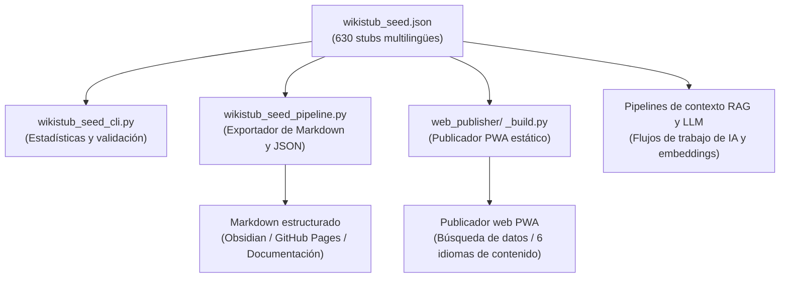

# WikiStub-Seed

[EN](README.md) | [DE](README_de.md) | **ES** | [JA](README_ja.md) | [RU](README_ru.md) | [ZH](README_zh-Hans.md)

**WikiStub-Seed es un marco de conocimiento JSON multilingüe para investigación asistida por IA, documentación, sistemas de aprendizaje y flujos de trabajo con LLM.** Incluye 630 stubs en 12 dominios. Las definiciones están completas en DE/EN/ES/ZH/JA/RU; las notas de relevancia están completas en DE/ES/ZH/JA/RU y usan el fallback alemán para los slots ingleses vacíos.

WikiStub-Seed es una biblioteca semilla de stubs de conocimiento, no un wiki.

[](https://github.com/dev-bricks/WikiStub-Seed/actions/workflows/tests.yml)
[](pyproject.toml)
[](https://github.com/dev-bricks)
[](https://github.com/open-bricks)


[](https://github.com/astral-sh/ruff)
[](NOTICE)
[](MARKETING-LOG.txt)
[](llms.txt)


## Empezar aquí

| Si quieres... | Abre esto |
|---|---|
| Inspeccionar el conjunto de datos | `wikistub_seed.json` |
| Ejecutar una comprobación local rápida | `python wikistub_seed_cli.py check` |
| Exportar Markdown para documentación o notas | `python wikistub_seed_pipeline.py export --output --english` |
| Entender el formato de intercambio | `EXPORTFORMAT.md` |
| Explorar el código fuente de la PWA estática | `web_publisher/` |
| Leer el archivo índice para IA/LLM | [llms.txt](llms.txt) |
| Leer la guía en inglés | [README.md](README.md) |

> [!NOTE]
> **Integración con IA y LLM**: para contexto legible por máquinas, estructura del repositorio, frases de búsqueda y directrices para LLM, consulta [llms.txt](llms.txt).

## Arquitectura y flujo de datos



## Contexto de descubrimiento

Usa el nombre canónico del repositorio `dev-bricks/WikiStub-Seed` al enlazar o buscar. El proyecto estuvo relacionado anteriormente con `file-bricks/MetaWiki`, pero el repositorio actual es la biblioteca semilla de stubs de conocimiento de dev-bricks.

Frases de búsqueda que describen bien este proyecto:

- `WikiStub-Seed JSON knowledge stubs`
- `bilingual JSON knowledge base Python`
- `local-first ontology seed library for LLM workflows`
- `multilingual knowledge stubs framework`
- `RAG knowledge base German English JSON`

## Contenido

- 630 stubs en `wikistub_seed.json` con definiciones en seis idiomas y notas de relevancia en cinco
- 12 dominios de primer nivel, incluidos matemáticas, física, química, biología, medicina, psicología, IA, ingeniería, sociedad, economía, historia y cultura
- 85 subcategorías con definiciones cortas y neutrales y notas de relevancia
- Mapas canónicos `definitions.{lang}` y `relevance_i18n.{lang}` conservando los campos heredados `definition_de`, `definition_en` y `relevance`
- Herramientas CLI en Python para estadísticas, validación, comprobaciones de consistencia y exportación a Markdown
- Una dirección de exportación documentada `wikistub-seed-data-v1` para uso futuro en sitios Web/PWA estáticos
- Las comprobaciones, estadísticas y exportaciones principales del checkout usan la biblioteca estándar de Python; la traducción opcional, las integraciones de búsqueda y las comprobaciones de desarrollo tienen dependencias adicionales.

## Casos de uso

- Crear una base de conocimiento local para escritura o investigación asistida por IA
- Construir glosarios de documentación, mapas de aprendizaje o catálogos de conceptos
- Exportar Markdown estructurado para Obsidian, GitHub Pages o sitios estáticos
- Alimentar pipelines de recuperación, embeddings o contexto LLM con stubs de dominio compactos
- Traducir y ampliar un esqueleto de conocimiento neutro en dominio en un formato JSON controlado

## Estructura de datos

Cada stub está intencionalmente diseñado para ser pequeño y legible por máquina:

```json
{
  "title": "Domain-Driven Design",
  "definition_de": "Ein Ansatz zur Modellierung komplexer Software, der die Fachdomäne in den Mittelpunkt stellt.",
  "definition_en": "An approach to modeling complex software that places the business domain at the center of development.",
  "relevance": "Hilft, komplexe Systeme verständlich und wartbar zu gestalten.",
  "definitions": {
    "de": "Ein Ansatz zur Modellierung komplexer Software, der die Fachdomäne in den Mittelpunkt stellt.",
    "en": "An approach to modeling complex software that places the business domain at the center of development.",
    "es": "Un enfoque para modelar software complejo que sitúa el dominio de especialidad en el centro.",
    "zh": "一种对复杂软件进行建模的方法，它将专业领域置于中心位置。",
    "ja": "専門領域をその中心に据える、複雑なソフトウェアをモデリングするためのアプローチ。",
    "ru": "Подход к моделированию сложного программного обеспечения, который ставит предметную область в центр внимания."
  },
  "relevance_i18n": {
    "de": "Hilft, komplexe Systeme verständlich und wartbar zu gestalten.",
    "en": "",
    "es": "Ayuda a que los sistemas complejos sean comprensibles y mantenibles.",
    "zh": "有助于使复杂系统更易于理解和维护。",
    "ja": "複雑なシステムを理解しやすく、保守しやすく構築するのに役立ちます。",
    "ru": "Помогает сделать сложные системы понятными и простыми в сопровождении."
  },
  "tags": ["Informatik", "Software Engineering"]
}
```

La fuente autoritativa actual es `wikistub_seed.json`. `EXPORTFORMAT.md` documenta el formato envolvente estable `wikistub-seed-data-v1` para exportaciones Web/PWA, API y LLM.

## Inicio rápido

```bash
git clone https://github.com/dev-bricks/WikiStub-Seed.git
cd WikiStub-Seed

python wikistub_seed_cli.py --help
python wikistub_seed_cli.py stats
python wikistub_seed_cli.py check
python wikistub_seed_pipeline.py validate
python wikistub_seed_pipeline.py export --output --english
```

El flujo completo de CLI, el conjunto de datos y la PWA se usa desde el checkout del código fuente. El wheel contiene seis módulos API reutilizables, no el CLI ni el publicador. Las mutaciones desde una instalación requieren rutas externas de datos y autenticación elegidas expresamente; `site-packages` no se usa como almacén de datos del usuario.

En Windows, `start.bat` abre el punto de entrada de la CLI. Los archivos exportados se escriben en `output/`; esa carpeta es local y no está versionada.

## Comandos principales

| Comando | Propósito |
|---|---|
| `python wikistub_seed_cli.py stats` | Mostrar estadísticas de stubs, categorías y etiquetas |
| `python wikistub_seed_cli.py check` | Ejecutar comprobaciones de consistencia sobre el conjunto de datos JSON |
| `python wikistub_seed_pipeline.py validate` | Validar los datos de entrada de la pipeline |
| `python wikistub_seed_pipeline.py export --output --english` | Exportar el conjunto de datos JSON a Markdown |
| `python wikistub_seed_pipeline.py translate --confirm-api-cost --max-budget-usd AMOUNT` | Traducir definiciones inglesas faltantes tras confirmar el coste y fijar un límite |

## Mapa del repositorio

| Ruta | Propósito |
|---|---|
| `wikistub_seed.json` | Conjunto de datos de conocimiento multilingüe autoritativo |
| `01_Mathematik/` ... `12_Kultur_Kunst_Sprache/` | Estructura de fuente/exportación Markdown orientada a dominio |
| `wikistub_seed_cli.py` | CLI para estadísticas y comprobaciones |
| `wikistub_seed_pipeline.py` | Pipeline de importación, exportación, validación y traducción opcional |
| `md_to_json.py` | Herramienta auxiliar de importación Markdown a JSON |
| `check_duplicates.py` | Herramienta auxiliar de duplicados/consistencia |
| `EXPORTFORMAT.md` | Plan de formato de intercambio estable |
| `web_publisher/` | Publicador PWA estático; el service worker puede guardar recursos y datos del sitio tras una carga correcta, y el selector cambia el idioma del contenido |

## Privacidad

Las comprobaciones y exportaciones de CLI trabajan con archivos locales. La PWA estática solicita el conjunto de datos y el índice al mismo origen; después de una carga correcta, el service worker puede conservar en caché el contenido y los recursos del sitio. La primera visita y las actualizaciones necesitan acceso al sitio.
El selector de la PWA cambia el idioma de los datos, no traduce toda la interfaz. Las definiciones están disponibles en seis idiomas; las notas de relevancia tienen fallback alemán para los slots ingleses vacíos.
La traducción opcional envía solicitudes al servicio API de Anthropic y requiere `ANTHROPIC_API_KEY` y el paquete opcional `anthropic`. La CLI exige además `--confirm-api-cost` y un `--max-budget-usd` positivo. `translate_text` y `translate_batch` reciben el presupuesto como argumento `max_budget_usd`; la estimación local no garantiza el importe facturado.

## Hoja de ruta

Completado:

- 12 dominios de primer nivel y 85 subcategorías
- 630 stubs multilingües en un único archivo maestro JSON
- Herramientas de exportación a Markdown y sincronización JSON
- Pruebas de humo CLI en GitHub Actions, más pruebas de humo de fuente dedicadas para macOS/Linux de `wikistub_seed_cli.py check` y `wikistub_seed_pipeline.py validate`
- Publicador PWA estático con búsqueda; tras una carga correcta pueden quedar en caché los recursos y datos del sitio (`web_publisher/`).
- Envolvente de esquema `wikistub-seed-data-v1` con mapas DE/EN/ES/ZH/JA/RU

Planificado:

- Limpieza unificada de etiquetas
- Rutas de exportación para Obsidian/GitHub Pages
- Embeddings opcionales y API de búsqueda

## Deutsch

**WikiStub-Seed ist ein mehrsprachiges JSON-Wissensgerüst.** Definitionen sind in DE/EN/ES/ZH/JA/RU gefüllt; Relevanztexte in DE/ES/ZH/JA/RU, mit deutschem Fallback für Englisch.

WikiStub-Seed arbeitet mit den lokal angegebenen JSON-/Markdown-Dateien. Die statische PWA lädt Daten und Ressourcen vom selben Ursprung und kann sie nach dem Laden im Service Worker zwischenspeichern; Erstaufruf und Aktualisierungen benötigen den Zugriff auf die Website. Die Sprachauswahl wechselt die Inhaltssprache, nicht die gesamte Oberfläche. Die optionale Übersetzung sendet Anfragen an Anthropic und erfordert `ANTHROPIC_API_KEY` sowie das optionale Paket `anthropic`. Die CLI verlangt zusätzlich `--confirm-api-cost` und ein positives `--max-budget-usd`; die Modul-APIs `translate_text` und `translate_batch` verlangen ein explizites `max_budget_usd`. Die lokale Schätzung garantiert nicht den abgerechneten Betrag.

Wichtige Einstiegspunkte:

- `python wikistub_seed_cli.py stats` zeigt Statistik und Kategorien.
- `python wikistub_seed_cli.py check` prüft den Datenbestand.
- `python wikistub_seed_pipeline.py export --output --english` exportiert Markdown.
- `EXPORTFORMAT.md` beschreibt den geplanten stabilen Austauschstandard.
- `web_publisher/` enthält eine statische PWA mit Suche und einem Sprachwähler für die Inhalte; geladene Website-Ressourcen und Daten können im Service Worker zwischengespeichert werden.

<!-- BEGIN ELLMOS BUNDLE DISCOVERY ES -->

## Bundles y socios

Proyección de descubrimiento verificada para `module:WikiStub-Seed` procedente
de `catalog:v4-bundles`
(`546290dafbaafd810df1d59ef5a3d7183738472b48cd5a8a81f1e8f2b64d852e`).
El repositorio de destino es `public`. Los manifiestos de los bundles siguen
siendo la autoridad sobre la pertenencia; esta sección no instala ni activa
componentes. La aprobación se basa en un registro público del módulo y en una
lista de bundles permitidos explícita con política default-deny.

### `ellmos-knowledge-bundle`

- Visibilidad de la receta del bundle: `private`; rol:
  `declared-component`; requisito: `recommended`.
- Socios de módulo: `module:KnowledgeDigest`,
  `module:project-docs-template`, `module:report-forge`,
  `module:web-scraper`.
- Socios de skill: `skill:bilingual-doc-sync`, `skill:docs-analysis`,
  `skill:document-chunker`.

Los detalles de composición y runtime se omiten intencionadamente.

<!-- END ELLMOS BUNDLE DISCOVERY ES -->

## Licencia

Licencia MIT. Véase `LICENSE`.
