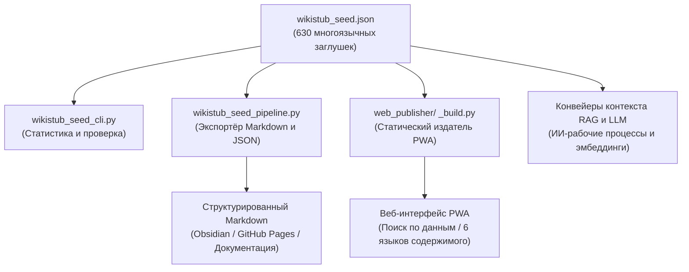

# WikiStub-Seed

[EN](README.md) | [DE](README_de.md) | [ES](README_es.md) | [JA](README_ja.md) | **RU** | [ZH](README_zh-Hans.md)

**WikiStub-Seed — это многоязычный JSON-фреймворк знаний.** В нём 630 статей в 12 областях: определения заполнены на DE/EN/ES/ZH/JA/RU, а пояснения значимости — на DE/ES/ZH/JA/RU с немецким fallback для пустых английских слотов.

WikiStub-Seed — это начальная библиотека заглушек знаний, не вики.

[](https://github.com/dev-bricks/WikiStub-Seed/actions/workflows/tests.yml)
[](pyproject.toml)
[](https://github.com/dev-bricks)
[](https://github.com/open-bricks)


[](https://github.com/astral-sh/ruff)
[](NOTICE)
[](MARKETING-LOG.txt)
[](llms.txt)


## С чего начать

| Если вы хотите... | Откройте |
|---|---|
| Просмотреть набор данных | `wikistub_seed.json` |
| Выполнить быструю локальную проверку | `python wikistub_seed_cli.py check` |
| Экспортировать Markdown для документации или заметок | `python wikistub_seed_pipeline.py export --output --english` |
| Понять формат обмена | `EXPORTFORMAT.md` |
| Посмотреть исходный код статической PWA | `web_publisher/` |
| Прочитать индексный файл для ИИ/LLM | [llms.txt](llms.txt) |
| Прочитать руководство на английском | [README.md](README.md) |

> [!NOTE]
> **Интеграция с ИИ и LLM**: машиночитаемый контекст, структуру репозитория, поисковые фразы и рекомендации для LLM см. в [llms.txt](llms.txt).

## Архитектура и поток данных



## Контекст обнаружения

При ссылках и поиске используйте каноническое имя репозитория `dev-bricks/WikiStub-Seed`. Ранее проект был связан с `file-bricks/MetaWiki`, но текущий репозиторий — это библиотека-заготовка knowledge-стабов dev-bricks.

Поисковые фразы, хорошо описывающие этот проект:

- `WikiStub-Seed JSON knowledge stubs`
- `bilingual JSON knowledge base Python`
- `local-first ontology seed library for LLM workflows`
- `multilingual knowledge stubs framework`
- `RAG knowledge base German English JSON`

## Содержимое

- 630 статей в `wikistub_seed.json` с определениями на шести языках
- 12 предметных областей верхнего уровня, включая математику, физику, химию, биологию, медицину, психологию, ИИ, инженерию, общество, экономику, историю и культуру
- 85 подкатегорий с краткими нейтральными определениями и заметками о релевантности
- Канонические карты `definitions.{lang}` и `relevance_i18n.{lang}` при сохранении устаревших полей `definition_de`, `definition_en` и `relevance`
- Инструменты CLI на Python для статистики, валидации, проверок согласованности и экспорта в Markdown
- Документированное направление экспорта `wikistub-seed-data-v1` для будущего использования на статических веб-сайтах/PWA
- Основные проверки данных, статистика и экспорт в исходном checkout используют стандартную библиотеку Python; дополнительный перевод, интеграции поиска и проверки разработки имеют отдельные зависимости.

## Варианты использования

- Создание локальной базы знаний для написания текстов или исследований с поддержкой ИИ
- Построение глоссариев документации, карт обучения или каталогов концепций
- Экспорт структурированного Markdown для Obsidian, GitHub Pages или статических сайтов
- Наполнение конвейеров поиска, встраивания или контекста LLM компактными заглушками предметной области
- Перевод и расширение доменно-нейтрального скелета знаний в контролируемом формате JSON

## Структура данных

Каждая заглушка намеренно сделана небольшой и машиночитаемой:

```json
{
  "title": "Domain-Driven Design",
  "definition_de": "Ein Ansatz zur Modellierung komplexer Software, der die Fachdomäne in den Mittelpunkt stellt.",
  "definition_en": "An approach to modeling complex software that places the business domain at the center of development.",
  "relevance": "Hilft, komplexe Systeme verständlich und wartbar zu gestalten.",
  "definitions": {
    "de": "Ein Ansatz zur Modellierung komplexer Software, der die Fachdomäne in den Mittelpunkt stellt.",
    "en": "An approach to modeling complex software that places the business domain at the center of development.",
    "es": "Un enfoque para modelar software complejo que sitúa el dominio de especialidad en el centro.",
    "zh": "一种对复杂软件进行建模的方法，它将专业领域置于中心位置。",
    "ja": "専門領域をその中心に据える、複雑なソフトウェアをモデリングするためのアプローチ。",
    "ru": "Подход к моделированию сложного программного обеспечения, который ставит предметную область в центр внимания."
  },
  "relevance_i18n": {
    "de": "Hilft, komplexe Systeme verständlich und wartbar zu gestalten.",
    "en": "",
    "es": "Ayuda a que los sistemas complejos sean comprensibles y mantenibles.",
    "zh": "有助于使复杂系统更易于理解和维护。",
    "ja": "複雑なシステムを理解しやすく、保守しやすく構築するのに役立ちます。",
    "ru": "Помогает сделать сложные системы понятными и простыми в сопровождении."
  },
  "tags": ["Informatik", "Software Engineering"]
}
```

Текущим авторитетным источником является `wikistub_seed.json`. `EXPORTFORMAT.md` документирует стабильный формат-обёртку `wikistub-seed-data-v1` для веб-/PWA-, API- и LLM-экспортов.

## Быстрый старт

```bash
git clone https://github.com/dev-bricks/WikiStub-Seed.git
cd WikiStub-Seed

python wikistub_seed_cli.py --help
python wikistub_seed_cli.py stats
python wikistub_seed_cli.py check
python wikistub_seed_pipeline.py validate
python wikistub_seed_pipeline.py export --output --english
```

В Windows `start.bat` открывает точку входа CLI. Экспортированные файлы записываются в `output/`; эта папка является локальной и не версионируется.

Полный рабочий процесс — CLI, набор данных и PWA — доступен в checkout исходного кода. Wheel предоставляет шесть повторно используемых API-модулей, но не CLI и PWA. Для изменения данных через установленный API нужно явно указать внешние пути к данным и аутентификации; `site-packages` не используется как хранилище пользовательских данных.

## Основные команды

| Команда | Назначение |
|---|---|
| `python wikistub_seed_cli.py stats` | Вывод статистики по заглушкам, категориям и тегам |
| `python wikistub_seed_cli.py check` | Запуск проверок согласованности набора данных JSON |
| `python wikistub_seed_pipeline.py validate` | Валидация входных данных конвейера |
| `python wikistub_seed_pipeline.py export --output --english` | Экспорт набора данных JSON в Markdown |
| `python wikistub_seed_pipeline.py translate --confirm-api-cost --max-budget-usd AMOUNT` | Перевод отсутствующих английских определений с подтверждением затрат и положительным лимитом |

## Карта репозитория

| Путь | Назначение |
|---|---|
| `wikistub_seed.json` | Авторитетный двуязычный набор данных знаний |
| `01_Mathematik/` ... `12_Kultur_Kunst_Sprache/` | Предметно-ориентированная структура источника/экспорта Markdown |
| `wikistub_seed_cli.py` | CLI для статистики и проверок |
| `wikistub_seed_pipeline.py` | Конвейер импорта, экспорта, валидации и опционального перевода |
| `md_to_json.py` | Вспомогательный инструмент импорта Markdown в JSON |
| `check_duplicates.py` | Вспомогательный инструмент для дубликатов/согласованности |
| `EXPORTFORMAT.md` | План стабильного формата обмена |
| `web_publisher/` | Статический PWA: после загрузки может кэшировать ресурсы и данные сайта; выбор языка меняет язык содержимого |

## Конфиденциальность

Основные команды CLI читают и записывают выбранные локальные файлы. Статический PWA загружает данные и ресурсы с того же источника; service worker может кэшировать их после успешной загрузки. Первый доступ и обновления требуют доступа к сайту. Выбор языка PWA переключает язык данных, но не переводит весь интерфейс.

Опциональный перевод отправляет запросы в Anthropic API и требует `ANTHROPIC_API_KEY` и необязательный пакет `anthropic`. CLI дополнительно требует `--confirm-api-cost` и положительный `--max-budget-usd`; модульные API `translate_text` и `translate_batch` требуют явный аргумент `max_budget_usd`. Локальная оценка не гарантирует фактическую сумму счета.

## Дорожная карта

Выполнено:

- 12 предметных областей верхнего уровня и 85 подкатегорий
- 630 двуязычных заглушек в едином главном файле JSON
- Инструменты экспорта в Markdown и синхронизации JSON
- Дымовые тесты CLI в GitHub Actions, а также специальные дымовые тесты источника для macOS/Linux для `wikistub_seed_cli.py check` и `wikistub_seed_pipeline.py validate`
- Статический PWA предоставляет поиск и может кэшировать загруженные ресурсы и данные сайта (`web_publisher/`)
- Схема-обёртка `wikistub-seed-data-v1` с языковыми картами DE/EN/ES/ZH/JA/RU

Запланировано:

- Единая очистка тегов
- Пути экспорта для Obsidian/GitHub Pages
- Опциональные встраивания и поисковый API

## Deutsch

**WikiStub-Seed ist ein mehrsprachiges JSON-Wissensgerüst.** Definitionen sind in DE/EN/ES/ZH/JA/RU gefüllt; Relevanztexte in DE/ES/ZH/JA/RU, mit deutschem Fallback für Englisch.

WikiStub-Seed arbeitet mit den lokal angegebenen JSON-/Markdown-Dateien. Die statische PWA lädt Daten und Ressourcen vom selben Ursprung und kann sie nach dem Laden im Service Worker zwischenspeichern; Erstaufruf und Aktualisierungen benötigen den Zugriff auf die Website. Die Sprachauswahl wechselt die Inhaltssprache, nicht die gesamte Oberfläche. Die optionale Übersetzung sendet Anfragen an Anthropic und erfordert `ANTHROPIC_API_KEY` sowie das optionale Paket `anthropic`. Die CLI verlangt zusätzlich `--confirm-api-cost` und ein positives `--max-budget-usd`; die Modul-APIs `translate_text` und `translate_batch` verlangen ein explizites `max_budget_usd`. Die lokale Schätzung garantiert nicht den abgerechneten Betrag.

Wichtige Einstiegspunkte:

- `python wikistub_seed_cli.py stats` zeigt Statistik und Kategorien.
- `python wikistub_seed_cli.py check` prüft den Datenbestand.
- `python wikistub_seed_pipeline.py export --output --english` exportiert Markdown.
- `EXPORTFORMAT.md` beschreibt den geplanten stabilen Austauschstandard.
- `web_publisher/` enthält eine statische PWA mit Suche und einem Sprachwähler für die Inhalte; geladene Website-Ressourcen und Daten können im Service Worker zwischengespeichert werden.

<!-- BEGIN ELLMOS BUNDLE DISCOVERY RU -->

## Бандлы и партнёры

Проверенная проекция обнаружения для `module:WikiStub-Seed`, созданная из
`catalog:v4-bundles`
(`546290dafbaafd810df1d59ef5a3d7183738472b48cd5a8a81f1e8f2b64d852e`).
Целевой репозиторий имеет видимость `public`. Манифесты бандлов остаются
авторитетным источником членства; этот раздел не устанавливает и не активирует
компоненты. Основание допуска — публичная запись реестра модуля и явный
default-deny список разрешённых бандлов.

### `ellmos-knowledge-bundle`

- Видимость рецепта бандла: `private`; роль: `declared-component`;
  требование: `recommended`.
- Партнёры-модули: `module:KnowledgeDigest`,
  `module:project-docs-template`, `module:report-forge`,
  `module:web-scraper`.
- Партнёры-скиллы: `skill:bilingual-doc-sync`, `skill:docs-analysis`,
  `skill:document-chunker`.

Подробности композиции и runtime намеренно опущены.

<!-- END ELLMOS BUNDLE DISCOVERY RU -->

## Лицензия

Лицензия MIT. См. `LICENSE`.
